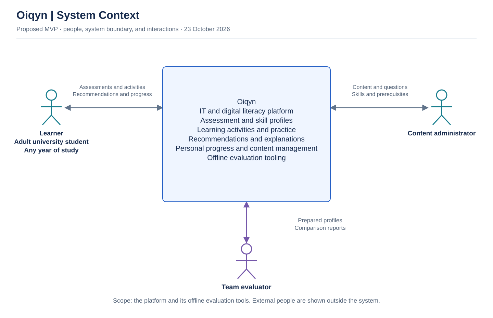
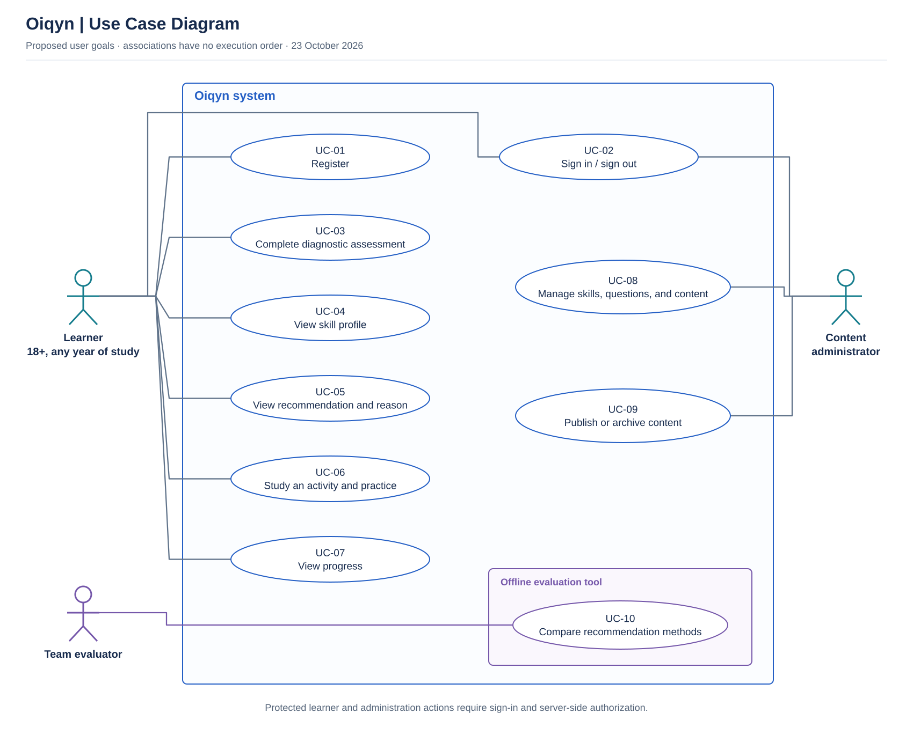
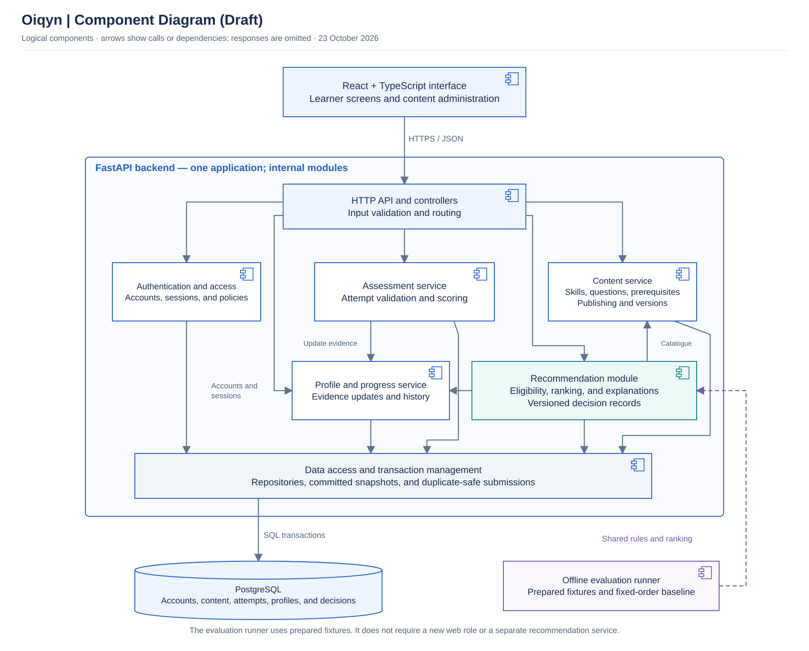

# Oiqyn — Architecture and Diagrams

**Project:** Development of a Literacy Platform with Personalized Learning Recommendation  
**Team:** Adilbekov Daniyal (SE-2414); Rassul Sakenov (SE-2403)  
**Prepared:** 23 October 2026  
**Status:** Proposed design for the first pre-defense; team and supervisor review pending

This folder addresses the required **Architecture and Diagrams** deliverable:
a system context diagram, a use case diagram, and a draft component diagram.
The diagrams describe the planned system, not an implemented deployment.

The target audience is university students aged 18 and over across different
years of study. The diagrams are aligned with the project scope,
[technology decisions](../docs/05-technologies.md),
[requirements specification](../docs/06-requirements.md), and
[recommendation design](../docs/07-recommendation-design.md).

## 1. Files and Editing

| File | Purpose |
|---|---|
| `01-system-context.svg` and `01-system-context.png` | System boundary and external people. |
| `02-use-cases.svg` and `02-use-cases.png` | Actors and the goals they can carry out. |
| `03-components.svg` and `03-components.png` | Proposed internal components and their dependencies. |
| `oiqyn-architecture.drawio` | Editable source containing all three diagrams as separate pages. |
| `README.md` | Architectural explanation, requirement mapping, and scenario walkthroughs. |

The SVG files preserve sharp text when resized. The PNG files can be inserted
into presentation slides. Open the `.drawio` file in diagrams.net to edit the
source. After editing a page, export and replace its corresponding SVG and PNG
so that the source and images remain consistent.

## 2. System Context

Oiqyn is represented as one system. Its boundary includes the web platform
and its offline evaluation tools; implementation components are shown in the
component diagram instead.

| External person | Interaction with Oiqyn |
|---|---|
| Learner | Submits assessment answers, studies activities, and receives feedback, recommendations, and personal progress. |
| Content administrator | Maintains skills, questions, activities, prerequisite links, and publication status. |
| Team evaluator | Runs controlled comparisons using prepared profiles and receives comparison reports. |

The team evaluator is a member of the project team performing technical
evaluation. This does not add a third team member or a new web application
permission role. The two planned application roles remain learner and content
administrator.

The current MVP does not require an external language-model API, university
system integration, or an external content service. GitHub and YouTrack
support project work; they are not runtime dependencies of the learning
platform.

## 3. Use Case Diagram

The rectangle marks the Oiqyn system boundary. Actors are outside it, and
ovals represent their goals. An association indicates participation, not
the order in which actions execute.

| Use case | Actor | Description | Requirements |
|---|---|---|---|
| UC-01 — Register | Learner | Create a learner account; registration cannot grant administrator access. | FR-01 |
| UC-02 — Sign in / sign out | Learner; content administrator | Start and end an authorized session. Administrator accounts are provisioned separately. | FR-01, FR-02 |
| UC-03 — Complete diagnostic assessment | Learner | Answer or skip questions, submit an attempt, and receive scored feedback. | FR-03, FR-04 |
| UC-04 — View skill profile | Learner | View evidence-based statuses, including insufficient evidence, with their evidence dates. | FR-05 |
| UC-05 — View recommendation and reason | Learner | Receive an eligible activity and explanation, or an explicit state when no recommendation is available. | FR-06, FR-07 |
| UC-06 — Study an activity and practice | Learner | Read material, record completion, submit or retake an assessment, and receive feedback. | FR-04, FR-08 |
| UC-07 — View progress | Learner | View personal completion history, attempts, and current progress; skill filtering is a Should feature. | FR-09, FR-13 |
| UC-08 — Manage skills, questions, and content | Content administrator | Create and edit content, answer explanations, and prerequisite links while retaining historical versions. | FR-10, FR-11 |
| UC-09 — Publish or archive content | Content administrator | Validate references and prerequisite structure, publish valid content, or remove content from new starts. | FR-10, FR-11 |
| UC-10 — Compare recommendation methods | Team evaluator | Run the personalized method and fixed-order baseline on the same prepared inputs and record outputs. | FR-12 |

Protected learner and administrator operations require sign-in and backend
authorization. The diagram does not imply that every operation repeats a login.
The evaluation use case runs through a separate command-line tool with prepared
fixtures, rather than through the learner interface.

## 4. Component Diagram — Draft

The backend is one FastAPI application with internal modules. A box labelled
“service” represents a logical responsibility, not a separately deployed
microservice. The recommendation module runs within that backend.

Arrows indicate calls or dependencies; responses are omitted. The purple
dashed arrow identifies offline reuse of the recommendation rules and ranking
code. The drawing is a draft component view with labelled technology boundaries,
not a deployment or infrastructure diagram.

| Component | Responsibility | Main data |
|---|---|---|
| React/TypeScript interface | Present learner screens and administration forms; send requests and display results. | Form input, assessment responses, activities, and progress views. |
| HTTP API and controllers | Validate request structure, enforce authorized access, and route requests to application services. | Authenticated identity, validated requests, and response models. |
| Authentication and access | Check credentials, session state, ownership, and role permissions. | Accounts, sessions, and access policies. |
| Assessment service | Validate attempt membership and question versions, score answers, and coordinate submission. | Attempts, submitted answers, answer keys, and scoring versions. |
| Profile and progress service | Apply evidence rules and provide committed skill profiles, completion records, and attempt history. | Skill evidence, evidence dates, and learning history. |
| Content service | Manage skills, questions, activities, prerequisites, publication state, and content versions. | Versioned catalogue and assessment content. |
| Recommendation module | Read the profile and catalogue, filter candidates, rank them, construct explanations, and record decisions. | Profile/catalogue snapshots, ranking configuration, factors, and decision trace. |
| Data access and transaction management | Provide repositories and transaction boundaries, including duplicate-safe submissions and consistent reads. | Persisted domain records and transaction state. |
| PostgreSQL | Store the application's relational records. | Accounts, content, attempts, profiles, completions, and decisions. |
| Offline evaluation runner | Load prepared fixtures, call shared eligibility/ranking functions, apply the fixed-order baseline, and write comparison outputs. | Versioned synthetic profiles, catalogue fixtures, and evaluation reports. |

The browser communicates with the API using HTTPS and JSON in an
internet-accessible deployment. Internal backend calls are ordinary application
calls. Only the data-access layer communicates with PostgreSQL; the browser
does not access the database directly.

Authorization is enforced before protected application operations. The diagram
shows the controllers' dependency on the authentication/access module; it does
not mean that downstream services may accept an arbitrary learner ID without
an authorization decision.

The assessment service coordinates a shared transaction for the attempt result
and its derived profile update. These changes must commit together or roll
back together. Repeating the same submitted attempt must not create additional
attempts or inflate progress.

For live recommendations, the profile and catalogue services provide committed
snapshots. The recommendation module stores the versions and factors used.
For offline evaluation, the runner supplies prepared snapshots directly to the
shared pure eligibility and ranking functions. It does not need access to
real learners' records or start the web server.

## 5. Main Scenario Walkthroughs

### Scenario A — Diagnostic assessment and first recommendation

1. The learner signs in through the interface.
2. The API checks the session and identifies the learner.
3. The content service supplies the published diagnostic question versions.
4. The learner submits answers, including any explicitly skipped questions.
5. The assessment service validates and scores the attempt.
6. The profile service derives skill evidence. The data-access layer commits
   the attempt result and profile changes within the shared transaction.
7. The recommendation module reads the committed profile and catalogue,
   filters prerequisites, and ranks eligible activities.
8. The interface displays the profile, feedback, and an activity with its
   reason, or an explicit empty state.

### Scenario B — Learning activity, practice, and updated progress

1. The learner opens the recommended activity; current availability is checked.
2. Completing the lesson creates a completion record without changing skill
   status by itself.
3. A related assessment is submitted and scored against its fixed content
   version.
4. A qualifying result updates skill evidence and the next recommendation.
5. The dashboard displays committed results and completion history.

### Scenario C — Content administration

1. An authorized administrator creates or edits skills, activities, questions,
   feedback, and prerequisite links.
2. The content service checks required fields, references, answer keys, and
   prerequisite cycles before publication.
3. Publishing creates an available version; existing attempts preserve the
   versions they originally used.
4. Archiving prevents new starts and new recommendations for that activity
   while preserving historical results.

### Scenario D — Controlled recommendation comparison

1. A team evaluator selects a versioned fixture catalogue and at least 20
   prepared profiles.
2. The runner uses the same eligibility rules for both methods.
3. It compares the proposed ranking with fixed baseline order and records
   outputs, exclusions, and decision factors.
4. Rule correctness is checked against expected cases. Educational relevance
   is evaluated separately under the planned review rubric.
5. Prepared profiles are not reported as real participants or learning gains.

## 6. Cross-cutting Requirements

| Requirements | Architectural implication |
|---|---|
| FR-02, NFR-01 | Backend authorization protects personal records and administration operations; credentials and sessions require appropriate protection. |
| FR-04, FR-05, FR-11 | Server-side scoring uses versioned questions; profile evidence remains traceable to submitted attempts. |
| FR-06, FR-07 | The recommendation module separates eligibility from ranking and retains the evidence behind explanations. |
| NFR-02 | Related writes share a transaction and a duplicate-submission policy. |
| NFR-03, NFR-04, NFR-06 | The interface must be assessed for accessibility, responsive behavior, and usability. Component separation does not prove these qualities. |
| NFR-05 | API latency and error rates will be measured under the conditions in document 06. No performance result is claimed. |
| NFR-07 | Setup, dependencies, migrations, fixtures, and verification commands must become reproducible during implementation. |

The diagrams are consistent with the proposed design, but they do not
establish that these requirements have been implemented or passed.

## 7. Review Record

- [x] Prepare the context, use case, and draft component diagrams.
- [x] Provide editable source and presentation-ready image exports.
- [x] Map use cases and components to the current requirements.
- [ ] Rassul reviews actor roles, scenarios, and component responsibilities.
- [ ] The team addresses review comments through the pull request.
- [ ] The supervisor reviews substantive architectural decisions.
- [ ] Record actual feedback and resulting changes in the project documentation.

Add the actual YouTrack issue and Pull Request links after they exist.

